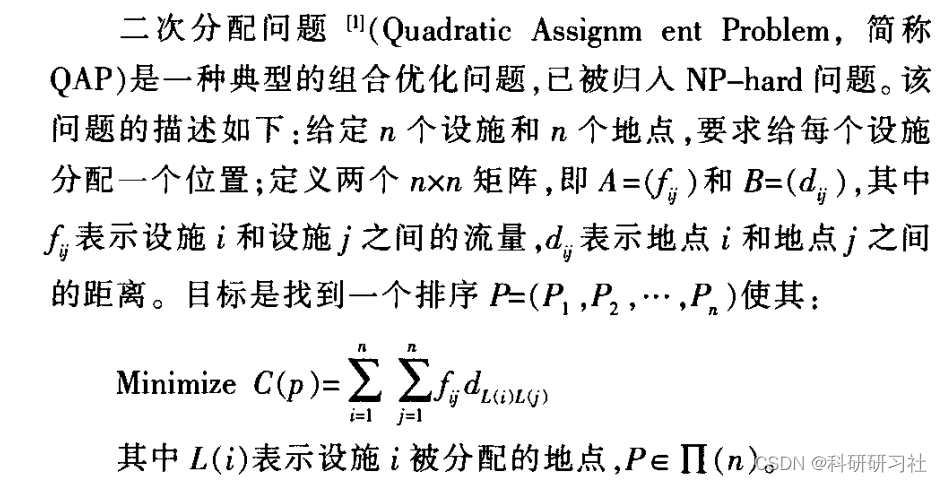
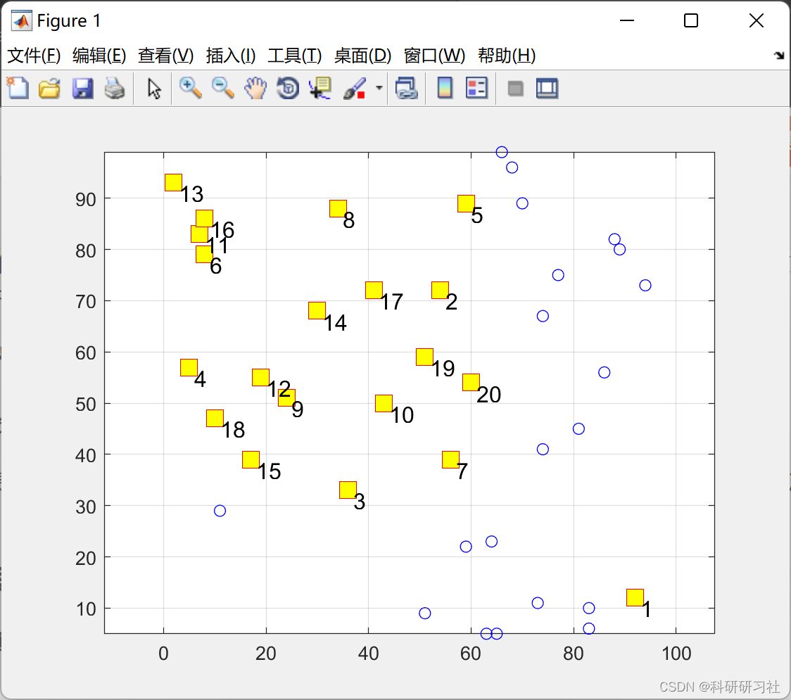
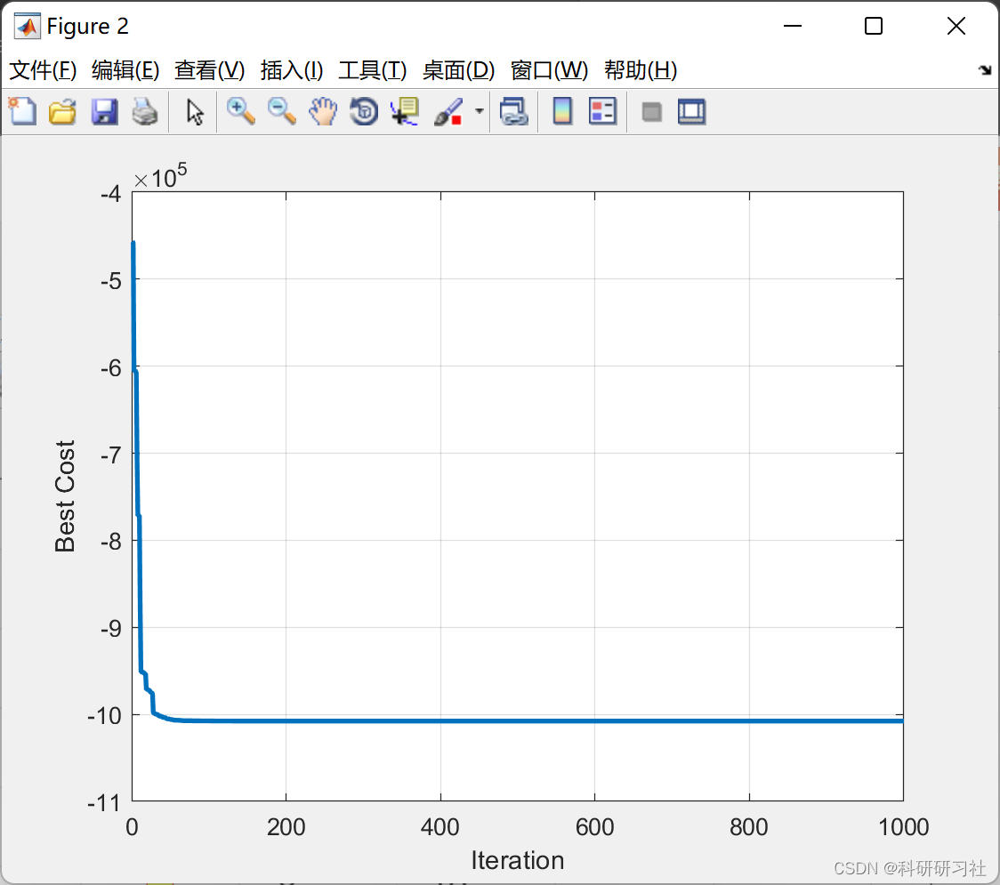
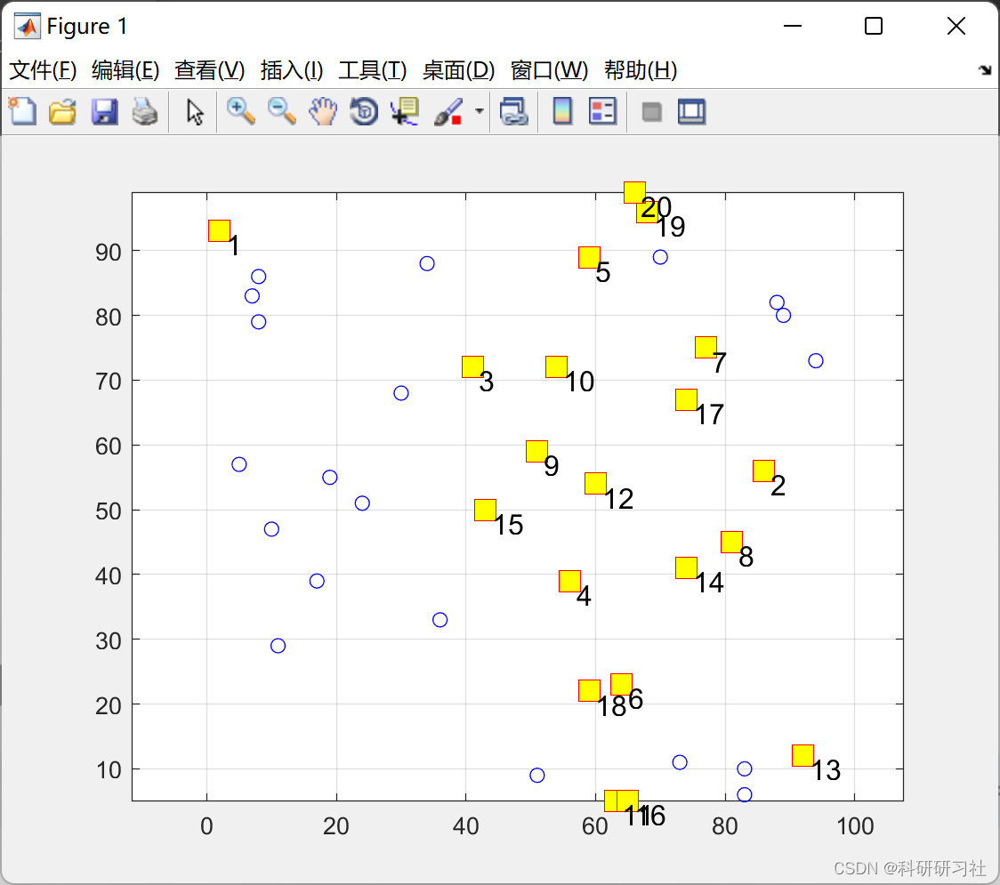
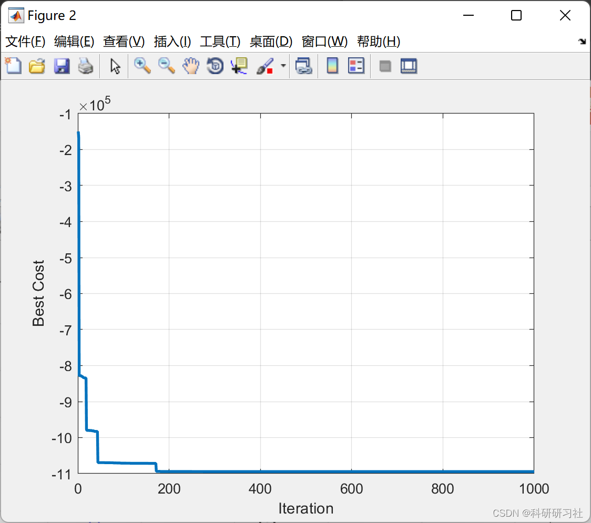
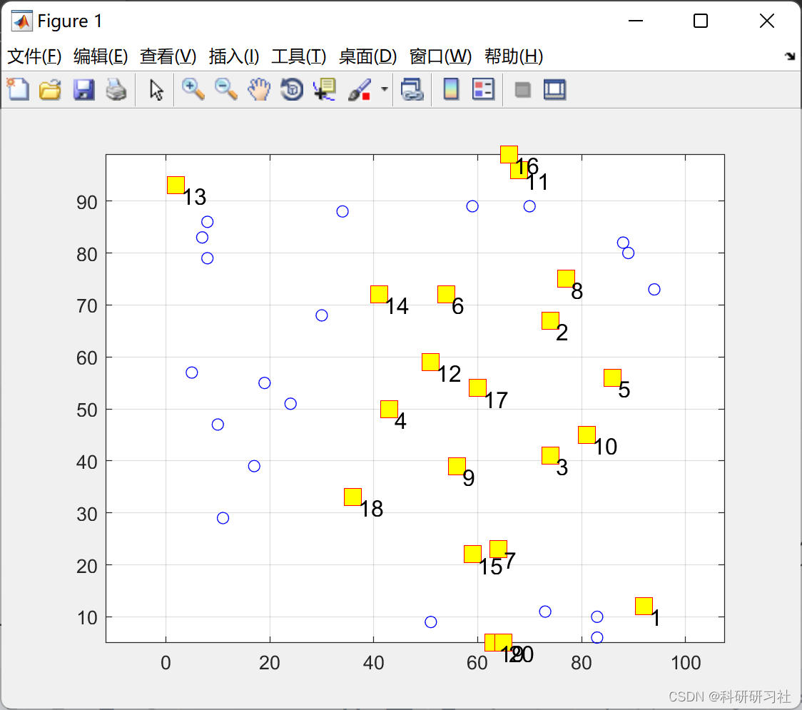
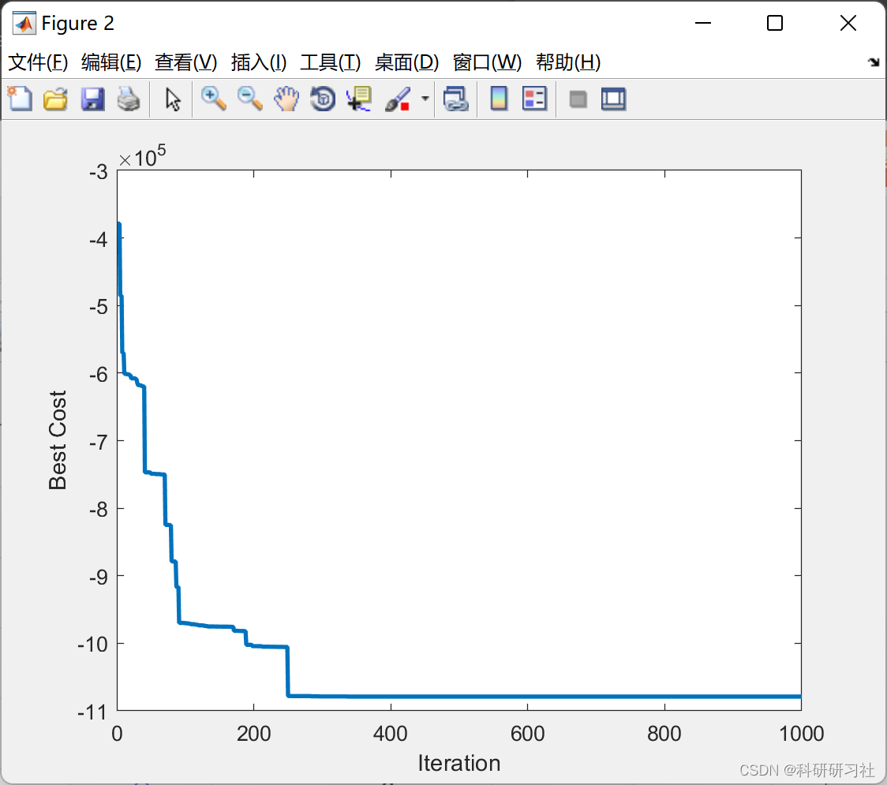

# [Secondary Allocation Problem] Solving the Secondary Allocation (QAP) Problem Based on Genetic Algorithms (GA), Particle Swarm Optimization (PSO), and Firefly Algorithm (FA)

​  
1. Overview
Currently, this issue has been thoroughly studied, with evolutionary strategies, genetic algorithms, genetic programming, and evolutionary programming collectively referred to as evolutionary computation (P) methods, and ant algorithms providing unique approaches for solving the problem. The Particle Swarm Optimization algorithm proposed by Kennedy et al. in 1995, also known as fK (Particle Swarm Optimization), became a new member of the evolutionary computation family. Compared to genetic algorithms, PSO does not involve complex crossover and mutation operations, making it simple and easy to program. Consequently, the algorithm immediately attracted special attention from researchers and was applied in many fields upon its introduction. This paper attempts to apply this algorithm to solve the quadratic assignment problem, and the experimental results demonstrate that the method is effective and feasible.
3. MATLAB Code and Article Reading - This article only showcases a portion of the code, please click the link for the full code and article:
[Secondary Allocation Problem]Solving the Secondary Allocation (QAP) Problem Based on Genetic Algorithm (GA), Particle Swarm Optimization (PSO), and Firefly Algorithm (FA) (MATLAB implementation)
4. Running Results
Editor
4.2 Particle Swarm Optimization Algorithm Editor
Editor
4.3 Genetic Algorithm Editing
Editor
​  

## Images

<!-- PAYMENT_BLOCK -->

## Get this dataset

- Payment link (Stripe): [Buy now](https://buy.stripe.com/3cs8yP7sY87d0vu9AB)
- Payment QR code: 

<!-- /PAYMENT_BLOCK -->
